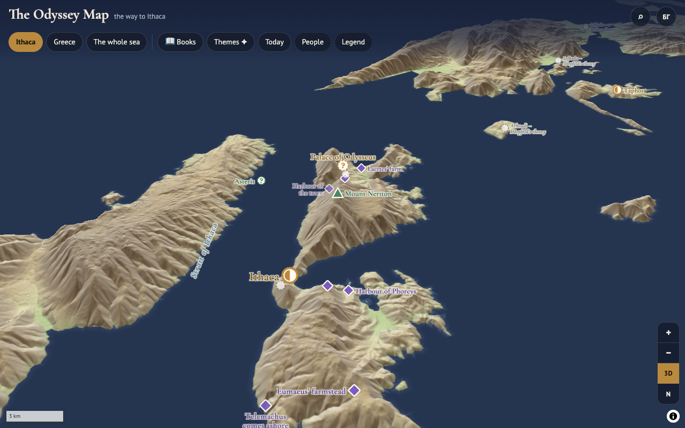
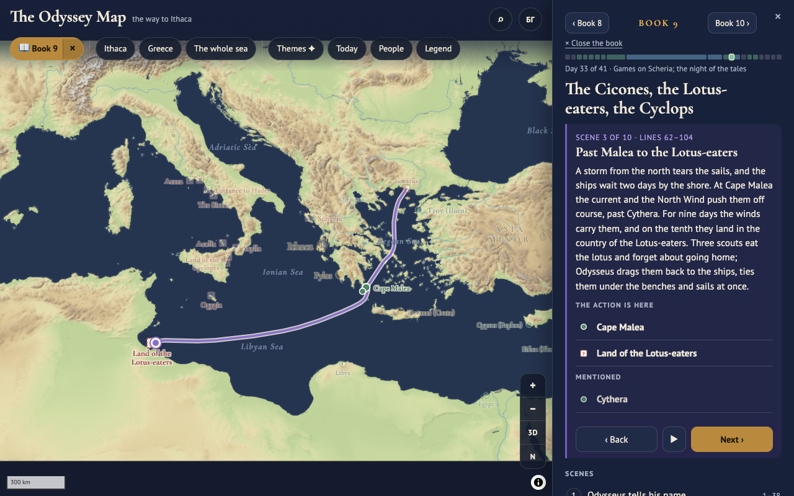
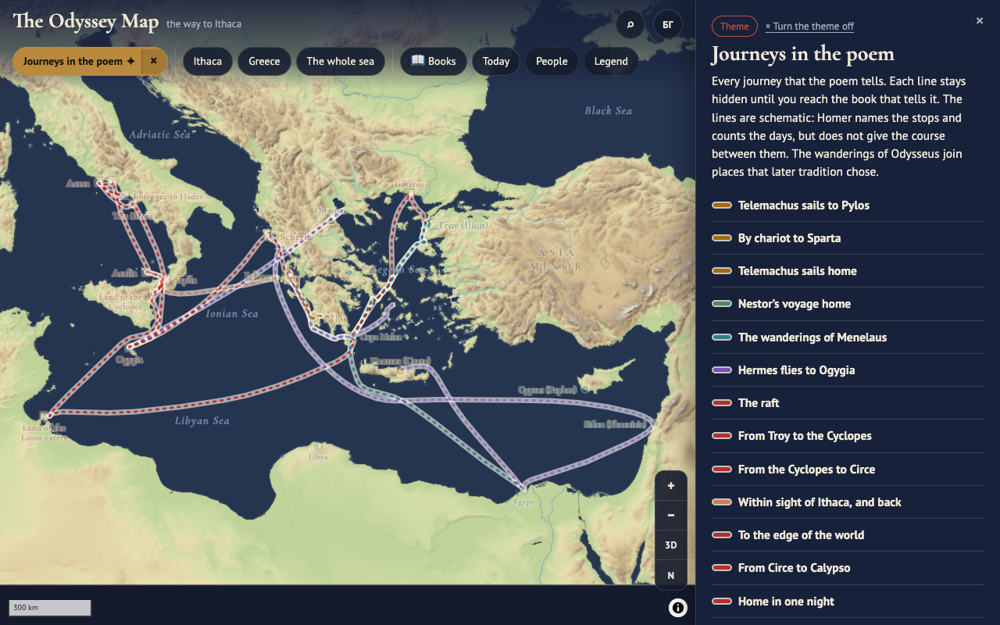
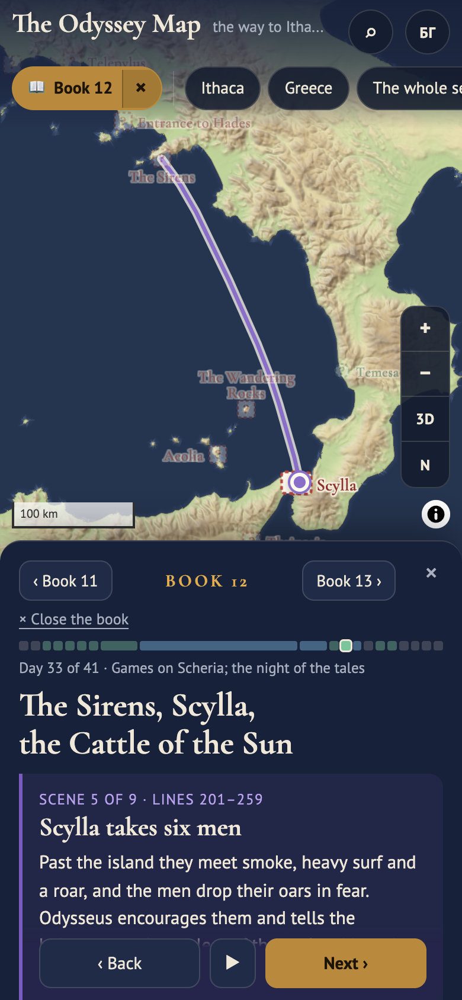

# The Odyssey Map

An interactive map for people who are reading Homer's *Odyssey* right now.

**Open the map: https://devladinci.github.io/odyssey-map/**

It answers three questions: where am I in the poem, who are these people, and where did it happen. For the *Odyssey* the third question has an honest second half: where did later readers *think* it happened, and how sure can anyone be?

It is the sister of [The Iliad Map](https://github.com/devladinci/iliad-map) and runs on the same engine.



| Reader mode, Book 9 | All the journeys | On a phone |
|---|---|---|
|  |  |  |

## What it does

- **Follows your reading.** Tell it which book you are on. Each book is split into scenes, 215 in all. Step through them and the map moves with the story.
- **Keeps the story to itself.** Anything that happens after your bookmark stays hidden until you get there. That includes the places: the Cyclops, Circe and the Sirens come onto the map only when Odysseus reaches them.
- **Is honest about what is known.** Troy, Pylos and Cape Malea are certain. The stops of the wanderings are not: they stand where Greek and Roman tradition put them, they are marked as disputed, and the other candidates are shown.
- **Draws every journey.** The wanderings of Odysseus, the voyage of Telemachus, the returns of Nestor and Menelaus, the flights of the gods, even the journeys inside the false tales. Each one plays on the map as a moving line. No ship sails over land: a script checks it.
- **Shows real terrain.** The whole Mediterranean, with fine detail on Ithaca. There is a 3D view, and you can stand on Mount Neriton and look towards the palace.
- **Knows the people.** Cards for 29 characters in four groups (the house of Odysseus, the suitors, kings and hosts, the wanderings), eight family trees, and the gods by the side they take.
- **Shows the shape of the poem.** A strip places each scene in the forty-one days of the action: the ten years of the wanderings are told in a single night.
- **Has themes:** how people have looked for the wanderings for 2,700 years, the kingdoms and how each king came home, the 108 suitors, archaeology, the gods and their places, winds and sailing, the edges of the world, the history behind the tale, names in Linear B, later shrines and tales, and coasts that have moved.
- **Links then to now.** A "Today" layer adds modern towns and borders, and a slider fades the coast of about 1200 BC into today's where it has been studied.
- **Works offline** once it has been opened, and can be added to a phone's home screen.
- **Speaks Bulgarian and English.** Search works in both at once.

## Run it

You need Node 22 or newer.

```bash
npm install
```

```bash
npm run dev
```

Other commands:

| Command | What it does |
|---|---|
| `npm run check` | Checks the content (ids, both languages, spoiler tags, scenes that cover every line) and that no sea journey crosses land |
| `npm run typecheck` | Checks the code |
| `npm run build` | Runs the checks and builds the site into `dist/` |
| `npm run smoke` | Walks through every scene in both languages, opens every card, theme and panel, tries the search, and fails on any page error (needs `npm run dev` running and Chrome installed) |
| `node scripts/shot.mjs out.png "#l=en&b=9&s=3"` | Takes a screenshot of a given state, for checking the look by eye |
| `node scripts/fetch-terrain.mjs` | Downloads the elevation tiles again |
| `node scripts/fetch-coast-detail.mjs` | Downloads the fine coastline of Ithaca and Cephalonia again |
| `node scripts/build-land.mjs <map.geo.json>` | Rebuilds the coastline of the sheet from `@geo-maps/earth-lands-100m` |
| `node scripts/fetch-rivers.mjs`, `node scripts/fetch-borders.mjs` | Rebuild the rivers and the modern borders |

## How it is organised

```
src/              the engine: map, reader mode, panels (TypeScript, MapLibre, Preact)
content/odyssey/  the Odyssey itself: places, routes, themes, scenes, people (data only)
  text/bg, en     the words, one folder per language
public/geo/       coastline, rivers, the coast of 1200 BC, kingdoms
public/terrain/   elevation tiles
scripts/          content checks, data downloads, screenshots
```

To change a text, a location or a certainty level, edit the JSON in `content/odyssey/`. The rules are in [content/README.md](content/README.md).

## Honesty rules

- **The wanderings are not on any ancient map.** Homer counts days and winds. The markers follow the oldest and most common ancient tradition, each one is marked "disputed", and each note says who put it there and when. The theme "Where did he sail?" tells the whole argument.
- Sites on Ithaca (the palace, the harbours, the farmstead of Eumaeus) are schematic. Some follow local tradition, some only the logic of the story. Each note says which.
- Routes are schematic. Homer names the stops, not the course between them.
- Summaries are in our own words. No published translation of the poem is quoted.
- Scene boundaries and line references were checked against the Greek text.
- [content/REVIEW.md](content/REVIEW.md) lists statements that still need a second look.

Found a mistake? Please open an issue and name your source.

## Credits and licences

- Code: MIT, see [LICENSE](LICENSE).
- Texts and place data: CC BY 4.0, see [LICENSE-content.md](LICENSE-content.md).
- The coastline, the elevation data, the gazetteer of ancient places, the rivers, the Greek text and the research behind the notes all come from others. Every source is named in [ATTRIBUTION.md](ATTRIBUTION.md), and the map itself shows the credits under the ⓘ button and in the legend.
